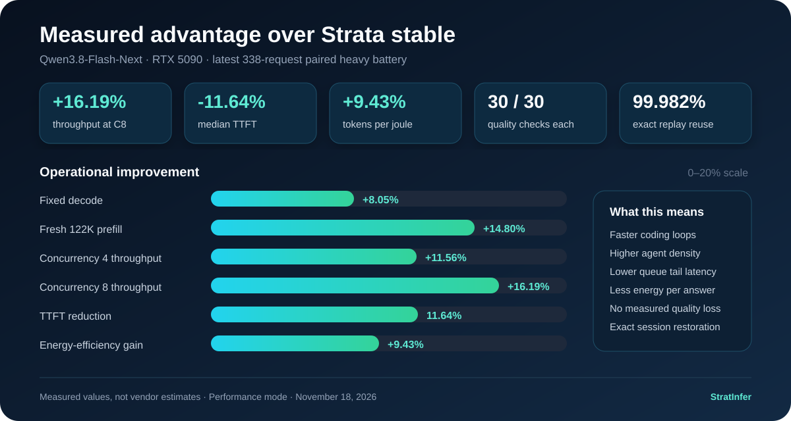
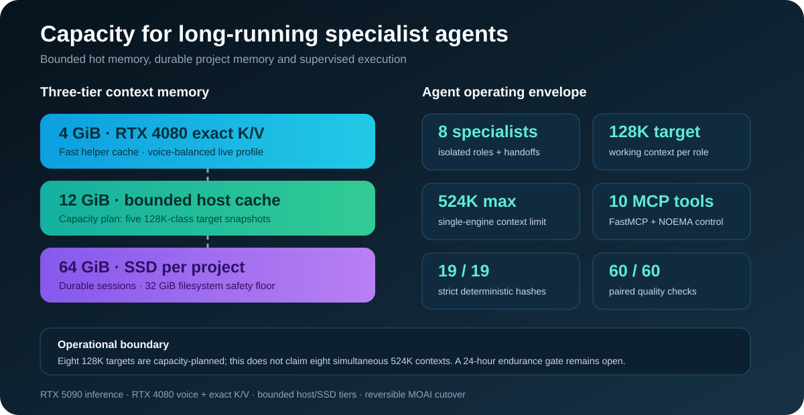

# StratInfer vs Strata: Final Operational, Performance and Capacity Report

**Validated platform:** Qwen3.8-Flash-Next · NVIDIA RTX 5090 (`sm_120`) · optional RTX 4080 helper · Windows 11 
**Primary evidence date:** November 18, 2026 
**Decision:** use StratInfer as the default engine for interactive coding, fresh long
contexts and concurrent agents; retain Strata as the rollback baseline.

> **Positioning:** StratInfer turns the Strata inference core into a measured,
> long-running agent platform: faster under sustained load, more energy-efficient per
> answer, durable across sessions, tool-capable, supervised and optionally deterministic.

## Executive decision

StratInfer wins the current deployment decision because it combines measurable inference
gains with capabilities that Strata stable does not provide in this configuration:
bounded multi-tier context memory, specialist-agent orchestration, FastMCP, NOEMA
supervision, exact session persistence and a fast deterministic qualification profile.

The latest heavy battery executed **169 requests per engine, 338 total**. StratInfer
improved aggregate fixed decode by **8.05%**, fresh 122K-token prefill by **14.80%**,
concurrency-eight throughput by **16.19%**, median TTFT by **11.64%** and tokens per joule
by **9.43%**. Both engines passed **30/30 quality checks** and restored **99.9823%** of a
158K-token prompt exactly.

StratInfer is not universally superior. It used **342 MiB more RTX 5090 VRAM**, drew
**11.76% more peak board power**, and its first 158K hot restoration remains slightly
slower than the historical Strata result. Performance mode is also not byte-deterministic;
the separate deterministic profile fixes this at a measured **14.0% decode cost**.

## Final scorecard

| Decision metric | Strata stable | StratInfer | Operational difference | Winner |
|---|---:|---:|---:|---|
| fixed decode, 15 measurements | 86.913 tok/s | 93.907 tok/s | **+8.05%** | StratInfer |
| fresh prefill, about 122K tokens | 3,617 tok/s | 4,152 tok/s | **+14.80%** | StratInfer |
| concurrency 4 throughput | 108.21 tok/s | 120.72 tok/s | **+11.56%** | StratInfer |
| concurrency 8 throughput | 104.26 tok/s | 121.14 tok/s | **+16.19%** | StratInfer |
| concurrency 8 p95 latency | 30.697 s | 26.035 s | **-15.19%** | StratInfer |
| median TTFT | 642.8 ms | 568.0 ms | **-11.64%** | StratInfer |
| median 512-token wall time | 5.128 s | 4.526 s | **-11.74%** | StratInfer |
| board energy per 512-token request | 1,177.46 J | 1,076.04 J | **-8.61%** | StratInfer |
| energy efficiency | 0.4348 tok/J | 0.4758 tok/J | **+9.43%** | StratInfer |
| targeted quality | 30/30 | 30/30 | equal | Tie |
| exact 158K replay reuse | 99.9823% | 99.9823% | equal | Tie |
| first 158K hot resume | 1,402.2 ms | 1,493.1 ms patched* | **+6.5%** | Strata |
| peak RTX 5090 memory | 29,799 MiB | 30,141 MiB | **+342 MiB** | Strata |
| peak board power | 289.65 W | 323.71 W | **+34.06 W** | Strata |
| strict sampled-text determinism | not qualified in baseline profile | 19/19 | opt-in capability | StratInfer |
| durable multi-agent memory | no integrated tier | 4 GiB VRAM + 12 GiB host + 64 GiB SSD | new capability | StratInfer |

\* The patched StratInfer value is a later follow-up, not a same-process paired rerun
against Strata. A final cross-engine replay A/B remains open.

## Performance differences and their implications

### 1. Interactive generation

The heavy efficiency gate reduced median first-token latency by **74.8 ms** and total
512-token response time by **601.8 ms**. The value is operational rather than cosmetic:
an agent completes each think-code-check cycle sooner, so tools, tests and review loops
start earlier.

| Horizon | Implication |
|---|---|
| immediate | noticeably tighter coding and chat feedback loops |
| weeks | more completed agent iterations inside the same workday |
| months | less queue accumulation and less human idle time at review boundaries |

The fixed workload split is important. Code improved by **11.96%** and prose by **9.53%**.
The 32K-agent case improved only **1.37%**, with a confidence interval crossing zero;
do not promise a universal double-digit gain for every long-context decode.

### 2. Fresh long-context prefill

Fresh prefill improved from **3,617 to 4,152 tok/s**. Needle retrieval remained correct,
while measured latency improved as context grew:

| Real prompt | Strata | StratInfer | Latency reduction |
|---:|---:|---:|---:|
| 2,309 tokens | 2,631.6 ms | 2,480.0 ms | **5.76%** |
| 8,909 tokens | 3,860.5 ms | 3,715.0 ms | **3.77%** |
| 35,310 tokens | 11,291.5 ms | 10,197.6 ms | **9.69%** |
| 70,510 tokens | 20,565.8 ms | 18,199.9 ms | **11.50%** |

**Short-term effect:** repository ingestion, large diffs and project handoffs start
faster. **Long-term effect:** repeated context rebuilds during multi-day development lose
less wall time, especially when sessions branch or agents rotate.

### 3. Concurrent agents

StratInfer's strongest advantage appears under sustained concurrency. At eight requests,
aggregate throughput rose **16.19%** and p95 latency fell **4.662 seconds**. This is the
most relevant result for an orchestrator because the slowest agent often blocks the next
quality gate.

| Active requests | Throughput delta | p95 delta | Operational reading |
|---:|---:|---:|---|
| 1 | -1.51% | -5.54% | no throughput win established in this subtest |
| 2 | +11.89% | -9.71% | useful for planner/implementer pairs |
| 4 | +11.56% | -16.13% | strong multi-stage pipeline benefit |
| 8 | +16.19% | -15.19% | best fit for the specialist-agent design |

The concurrency-one result prevents an exaggerated claim: StratInfer is optimized for
the complete operating envelope, not guaranteed to win every isolated micro-scenario.

## Efficiency and scaling

StratInfer consumed **101.42 J less board energy** per measured 512-token response even
though average and peak power were higher. It finishes sooner; energy is the integral of
power over time.

| Efficiency signal | Difference | Practical consequence |
|---|---:|---|
| median board energy | -8.61% | less heat and energy per completed answer |
| tokens per joule | +9.43% | more useful output from the same energy budget |
| average power | +3.17% | cooling must sustain a slightly higher active load |
| peak power | +11.76% | PSU and transient headroom remain important |
| peak RTX 5090 VRAM | +1.15% | about 342 MiB less emergency headroom |

Linear projections from the measured medians, not endurance measurements:

| Scale projection | Strata | StratInfer | Saved by StratInfer |
|---|---:|---:|---:|
| 1M output tokens, aggregate fixed decode | 3 h 11 m 46 s | 2 h 57 m 29 s | **14 m 17 s** |
| 1M output tokens, concurrency 8 | 2 h 39 m 51 s | 2 h 17 m 35 s | **22 m 16 s** |
| 100K responses of 512 tokens | — | — | **16.72 accelerator-hours and 2.82 kWh** |
| 1M responses of 512 tokens | — | — | **167.17 accelerator-hours and 28.17 kWh** |

These projections assume the measured workload mix, clocks and thermals remain stable.
They exclude host, SSD, RTX 4080 and facility energy.

## Hot reload and exact session continuity

Both engines restored **158,424 of 158,452 prompt tokens** exactly. StratInfer's original
heavy result was 1,546.1 ms versus 1,402.2 ms for Strata. The follow-up implementation:

- skips parked token-vector comparisons that cannot beat the active prefix;
- improved the matched 25.4K hot-lookup median from **499.3 to 429.3 ms (-14.0%)**;
- adds a 2,048-token park-growth threshold to avoid repeated full K/V copies;
- reduced the later 158K StratInfer result to **1,493.1 ms**;
- delivered subsequent 39.7K short-turn resumes in **370.5 and 412.7 ms** after the
  initial snapshot.

**Operational implication:** the first branch restore still carries a snapshot-transfer
cost, but normal short coding turns no longer repay that cost every time. Very long agent
sessions benefit increasingly as the number of small continuations grows.

## Quality, determinism and control

### Quality parity

Strata and StratInfer each passed **30/30** targeted reasoning, coding, instruction and
long-context checks. This proves no regression on the tested battery; it does not prove
general intelligence superiority.

### Fast deterministic mode

Both normal performance profiles diverged in 12 of 13 seeded interleaving observations.
The cause was path-dependent numerical variation between CPU/GPU expert placement,
prompt restoration and PCIe miss routing. StratInfer now offers a separate profile that
freezes those routes and passed **19/19** hashes over two seeds.

| Deterministic-profile cost | Performance | Strict | Delta |
|---|---:|---:|---:|
| decode median | 126.8 tok/s | 109.0 tok/s | **-14.0%** |
| median TTFT | 532.2 ms | 528.0 ms | effectively equal |
| incremental efficiency | 0.6191 tok/J | 0.5178 tok/J | **-16.4%** |

Use strict mode for regression tests, qualification, reproducible incident analysis and
release gates. Use performance mode for daily interactive work.

### MCP and NOEMA

The active stack exposes six root-confined coding tools and four NOEMA control tools.
All 40 measured MCP/NOEMA calls in the heavy campaign succeeded. MCP remains request
scoped because tool schemas are expensive:

| Request path | Median latency | Prompt tokens | Operational policy |
|---|---:|---:|---|
| no MCP | 165.3 ms | 35 | default ordinary turn |
| schemas advertised | 1,775.2 ms | 1,231 | enable only when tools may be needed |
| StratInfer tool used | 2,756.6 ms | 1,566 | coding operation |
| NOEMA tool used | 3,233.8 ms | 1,821 | supervised control operation |

The tool itself is not the dominant cost; schema prefill and the second model round are.
Selective activation therefore matters more than micro-optimizing stdio transport.

## Capacity difference

StratInfer adds an operational memory system around the model rather than pretending the
model context window is infinite:

| Layer | Qualified capacity | Purpose | Long-term implication |
|---|---:|---|---|
| RTX 5090 | 524,288-token engine limit | active inference and K/V working set | maximum single active context |
| RTX 4080 helper | 4 GiB exact parked K/V | fastest inactive-session tier | rapid specialist switching while voice remains resident |
| host cache | 12 GiB | bounded hot snapshots | absorbs more agents without filling helper VRAM |
| project SSD | 64 GiB, 32 GiB free-space floor | durable sessions and matrix memory | survives restarts and multi-day work |
| orchestrator | 8 specialist roles, 128K target each | isolated stages, gates and handoffs | prevents one giant transcript from degrading every role |

The plan does **not** claim eight simultaneous 524K contexts. It targets eight 128K
working contexts, with capacity planning, compaction, eviction and restore. Using the
measured snapshot density, the current capacity model estimates five target snapshots in
host cache, one in the 4 GiB voice-balanced helper tier and 23 in the SSD snapshot
partition. The earlier two-helper-snapshot plan used a 6 GiB cap and is no longer the
live voice-balanced configuration.

The RTX 4080 also hosts Qwen3-ASR and Qwen3-TTS in the validated voice-balanced profile.
The separately qualified `agent-max` lease releases voice, preserves a 4 GiB reserve and
selects a 10 GiB helper cache, estimated at four hot snapshots. It is not the default,
and ASR/TTS are unavailable while that lease is held.

## Operational implications by horizon

| Horizon | Advantage | Constraint | Recommended action |
|---|---|---|---|
| day 0–30 | faster replies, prefill and C2–C8 throughput | slightly higher VRAM and peak power | keep StratInfer default with Strata rollback |
| month 1–3 | more agent iterations and fewer context rebuilds | MCP schemas are costly when always active | enforce request-scoped MCP |
| month 1–6 | durable specialist sessions and supervised promotion | SSD writes, quotas and compaction need monitoring | track cache hit rate, quota and SSD health |
| month 3–12 | deterministic qualification reduces flaky releases | strict mode costs 14% decode | use strict mode only in CI/release gates |
| year 1+ | bounded memory architecture scales better than one transcript | maintenance surface is larger than Strata | version profiles, retain rollback and rerun gates after upgrades |

## Risks and disadvantages

1. **More components:** MOAI, helper-GPU cache, FastMCP, NOEMA and SSD memory create a
   larger observability and upgrade surface than plain Strata.
2. **Higher instantaneous load:** peak board power increased 34.06 W and RTX 5090 memory
   increased 342 MiB in the heavy gate.
3. **First hot resume:** the latest patched StratInfer result is still about 6.5% slower
   than the historical paired Strata value; a new paired A/B is required.
4. **Selective tools required:** always-on MCP can add roughly 1.6 seconds and 1,196
   prompt tokens before an actual tool call.
5. **Strict mode trade-off:** exact sampled text costs 14.0% decode and 16.4%
   incremental energy efficiency.
6. **Open endurance gates:** 24-hour agent endurance, physical 64 GiB quota pressure and
   large-scale constrained-decoding validation remain pending.
7. **Hardware specificity:** results apply to this RTX 5090/4080, model, quantization,
   driver and storage configuration; they are not universal vendor benchmarks.

## Recommended production policy

| Situation | Recommended engine/profile | Reason |
|---|---|---|
| interactive coding and chat | StratInfer performance | lower TTFT and faster decode |
| fresh repository or long-document ingestion | StratInfer performance | +14.80% fresh prefill |
| two to eight specialist agents | StratInfer performance | +11.56% to +16.19% throughput at C4/C8 |
| long-running project with restarts | StratInfer long-session | bounded VRAM/host/SSD persistence |
| tool-free conversation | StratInfer without MCP schemas | avoids unnecessary schema overhead |
| coding or control action | StratInfer with scoped MCP | tools available only when needed |
| release qualification | StratInfer fast deterministic | 19/19 reproducible hashes |
| minimum complexity or emergency rollback | Strata stable | smaller operational surface |
| repeated first-restore-only benchmark | Strata until replay A/B rerun | current remaining latency advantage |

## Validation status

| Gate | Status |
|---|---|
| heavy inference requests | 338/338 completed across both arms |
| targeted quality | 60/60 combined |
| exact replay | passed on both engines |
| strict StratInfer determinism | 19/19 |
| FastMCP/NOEMA heavy calls | 40/40 |
| repository JavaScript tests | 25/25 |
| conversation-cache C++ checks | 4,844 passed |
| 24-hour multi-agent endurance | pending |
| full SSD quota-pressure run | pending |
| final paired replay after hot fix | pending |

## Evidence and interpretation rules

Primary paired evidence:

- [`heavy-strata-vs-stratinfer-2026-11-18.md`](heavy-strata-vs-stratinfer-2026-11-18.md)
- [`data/heavy-strata-vs-stratinfer-2026-11-18/summary.json`](data/heavy-strata-vs-stratinfer-2026-11-18/summary.json)

Follow-up evidence:

- [`hot-reload-determinism-2026-11-18.md`](hot-reload-determinism-2026-11-18.md)
- [`multi-agent-capacity-2026-11-10.md`](multi-agent-capacity-2026-11-10.md)
- [`noema-live-benchmarks-2026-11-18.md`](noema-live-benchmarks-2026-11-18.md)
- [`fastmcp-2026-11-02.md`](fastmcp-2026-11-02.md)

All headline percentages are directly measured unless a row explicitly says
"projection". Quality parity means parity on the declared battery only. Cross-campaign
hot-reload values are identified and are not presented as paired measurements.
